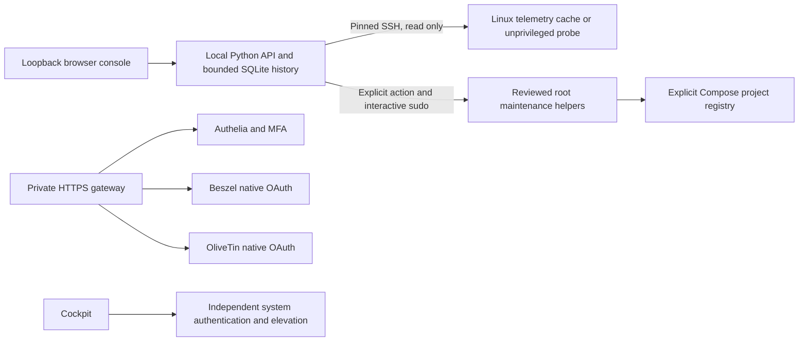

# Monitoring architecture

This module is independent of the Nextcloud host and application repositories.
It does not own storage, firewall/VPN policy, Nextcloud upgrades or user data.

The console listens exclusively on 127.0.0.1. Its random launch token is carried
in a URL fragment, then sessionStorage, and required as a bearer for API calls.
Mutations additionally require the exact Origin and Host. Demo mode rejects all
actions; live actions are also opt-in. No password is stored for sudo.

Collection is demand-driven while the local console runs. SSH failure, missing
data and samples older than three minutes produce an unknown/stale state and
block remote operations. No probe wakes hardware, runs SMART, inhibits suspend
or sends a magic packet automatically. The OS may suspend the admin PC; detailed
history can have gaps. An independent observer is needed to distinguish remote
power-off, suspend and network failure conclusively.

The optional privileged cache exports summaries, never Docker Env or logs. Its
reader group must be explicitly chosen by the operator. Root helpers read a
root-owned registry including all Compose override files, reject unknown running
containers and use a common maintenance/backup lock.

The SSO reference uses a dedicated HTTPS origin, separate from end-user apps.
Its internal token/userinfo endpoints also use TLS with a verified hostname and
trust chain. The internal TLS port is not published. Only the gateway and an
optional localhost agent endpoint are bound to loopback. The web containers have
no administration SSH key or Docker socket. See [SSO scope](sso.md).
